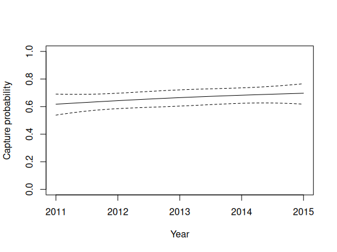
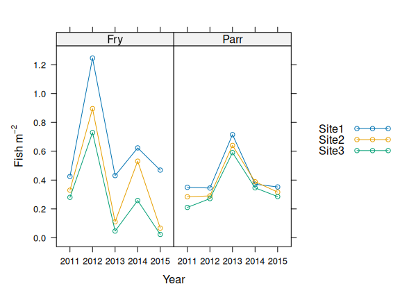

Modelling Capture Probability
================
9 October 2026

[](https://github.com/Faskally/ef/actions/workflows/R-CMD-check.yaml)

## the model

For a sample $s$ (a unique combination of site visit, species and
lifestage) fished with $n_s$ passes, let $y_{si}$ be the number of fish
caught on pass $i$ and $p_{si}$ the capture probability on that pass.
The probability that a fish is first caught on pass $i$ is

$$\pi_{si} = p_{si} \prod_{j < i} (1 - p_{sj})$$

Conditional on the total catch, $T_s = \sum_i y_{si}$, the counts are
multinomial with probabilities $\pi_{si} / P_s$, where
$P_s = \sum_i \pi_{si}$ is the cumulative capture probability. This
gives the log likelihood

$$\ell = \sum_s \left( \sum_i y_{si} \log \pi_{si} - T_s \log P_s \right)$$

which does not depend on the unknown number of fish at the site. Capture
probability is modelled on the logit scale

$$\text{logit}(p_{si}) = \mathbf{x}_{si}^\top \boldsymbol{\beta} + \mathbf{z}_{si}^\top \mathbf{b}, \qquad b_k \sim N(0, \sigma_{g(k)}^2)$$

where $\boldsymbol{\beta}$ are fixed effects and $\mathbf{b}$ are
optional random effects, for example for visit and sample, with one
standard deviation $\sigma_g$ for each random effect term. The random
effects are integrated out of the likelihood using the Laplace
approximation, and the fixed effects and standard deviations are
estimated by maximum likelihood using
[RTMB](https://cran.r-project.org/package=RTMB).

Fish density is then estimated by dividing the total catch by the area
fished and the cumulative capture probability: $T_s / (A_s P_s)$.

## installation

To install the `ef` package from r-universe run

``` r
install.packages("ef", repos = c('https://faskally.r-universe.dev', 'https://cloud.r-project.org'))
```

or to install the latest development version from GitHub run

``` r
remotes::install_github("faskally/ef")
```

# Create Required Fields for Analysis

Create a factor for pass with separate levels for the first and
subsequent passes. NOTE: Assuming the second and third pass have the
same capture probability avoids problems with model identifiability
([Millar *et al*., 2016](https://doi.org/10.1016/j.fishres.2016.01.001))

``` r
ef_data$pass12 <- factor(replace(ef_data$pass, ef_data$pass > 2, 2))
```

Create a sampleID for grouping EF counts together. A sample is a unique
combination of site visit x species x lifestage and is required by the
EF function

``` r
ef_data$sampleID <-
  as.numeric(
    factor(
      paste(ef_data$date, ef_data$siteID, ef_data$lifestage, ef_data$species)
    )
  )
```

Create a visitID for unique site visits. This is used to include between
visit variation as a random effect (see below).

``` r
ef_data$visitID <- factor(paste(ef_data$date, ef_data$siteID))
```

Create a factor for year

``` r
ef_data$fyear <- factor(ef_data$year)
```

# Fit a Model

Fit a simple model. This contains a factor for pass (2 levels),
lifestage (2 levels), site (3 levels) and year (5 levels). With a larger
dataset it would also be possible to add continuous variables as linear
or smoothed terms providing the degrees of freedom are specified
(typically up to k=3 (2 d.f.), see [Millar *et al*.,
2016](https://doi.org/10.1016/j.fishres.2016.01.001) for further
details)

``` r
m1 <-
  efp(
    count ~ siteID + fyear + pass12 + lifestage,
    data = ef_data, pass = pass, id = sampleID
  )
```

    ## 
    ## Call:
    ## efp(formula = count ~ siteID + fyear + pass12 + lifestage, data = ef_data, 
    ##     pass = pass, id = sampleID)
    ## 
    ## Formula:
    ## count ~ siteID + fyear + pass12 + lifestage
    ## 
    ## No random effects
    ## 
    ## Coefficients:
    ##                Estimate Std. Error  z value Pr(>|z^2|)
    ## (Intercept)    0.652301     0.1723  3.78656  1.527e-04
    ## siteIDSite2    0.074540     0.1354  0.55059  5.819e-01
    ## siteIDSite3   -0.023719     0.1473 -0.16098  8.721e-01
    ## fyear2012     -0.209949     0.1736 -1.20936  2.265e-01
    ## fyear2013      0.046976     0.1855  0.25317  8.001e-01
    ## fyear2014      0.358431     0.1834  1.95389  5.071e-02
    ## fyear2015     -0.004013     0.2114 -0.01899  9.849e-01
    ## pass122       -0.239160     0.1311 -1.82436  6.810e-02
    ## lifestageParr  0.590641     0.1210  4.88208  1.050e-06
    ## 
    ## Degrees of Freedom: 90 Total (i.e. Null);  81 Residual
    ## AIC: 3188

# Smooth Terms

Continuous covariates can be included as smooth terms using `s()`. The
smooths are unpenalised regression splines, no smoothing parameters are
estimated, so the flexibility of a smooth is set by its basis dimension
`k`, which should be kept small. Here the year factor is replaced by a
smooth trend with 2 degrees of freedom (`k = 3`).

``` r
ef_data$nyear <- as.numeric(as.character(ef_data$year))

m1_smooth <-
  efp(
    count ~ siteID + s(nyear, k = 3) + pass12 + lifestage,
    data = ef_data, pass = pass, id = sampleID
  )
```

    ## 
    ## Call:
    ## efp(formula = count ~ siteID + s(nyear, k = 3) + pass12 + lifestage, 
    ##     data = ef_data, pass = pass, id = sampleID)
    ## 
    ## Formula:
    ## count ~ siteID + s(nyear, k = 3) + pass12 + lifestage
    ## 
    ## No random effects
    ## 
    ## Coefficients:
    ##               Estimate Std. Error z value Pr(>|z^2|)
    ## (Intercept)    0.67060    0.11685  5.7392  9.514e-09
    ## siteIDSite2    0.08768    0.13409  0.6539  5.132e-01
    ## siteIDSite3   -0.02642    0.14629 -0.1806  8.567e-01
    ## pass122       -0.25099    0.13093 -1.9169  5.525e-02
    ## lifestageParr  0.60401    0.11247  5.3703  7.862e-08
    ## s(nyear).1     0.04792    0.23691  0.2023  8.397e-01
    ## s(nyear).2     0.12494    0.06299  1.9836  4.730e-02
    ## 
    ## Degrees of Freedom: 90 Total (i.e. Null);  83 Residual
    ## AIC: 3194

The smooth trend in capture probability, here for the first pass for fry
at Site1, with approximate 95% confidence intervals

``` r
newdata <-
  data.frame(
    siteID = "Site1", pass12 = "1", lifestage = "Fry",
    nyear = seq(2011, 2015, by = 0.1)
  )
pred <- predict(m1_smooth, newdata = newdata, se.fit = TRUE)

plot(newdata$nyear, invlogit(pred$fit), type = "l", ylim = c(0, 1),
     xlab = "Year", ylab = "Capture probability")
lines(newdata$nyear, invlogit(pred$fit - 2 * pred$se.fit), lty = 2)
lines(newdata$nyear, invlogit(pred$fit + 2 * pred$se.fit), lty = 2)
```

<!-- -->

The models with a year factor and a smooth trend in year can be compared
using AIC

``` r
AIC(m1, m1_smooth)
```

    ##           df      AIC
    ## m1         9 3188.305
    ## m1_smooth  7 3193.565

# Get Predicted Values for *P*

Predict *P* from the model to the full dataset. Note, if all the data is
multi-pass then can just use fitted values. However, if you want P for
both single and multi-pass data then predict to the new dataframe

``` r
ef_data$prob <- predict(m1, newdata = ef_data, type = "response")
```

Standard errors of the predictions are available using `se.fit = TRUE`.
To use the plotting and prediction tools in `mgcv` the model can also be
converted to a gam object using `as.gam(m1)`.

# Obtain Cumulative Estimates of *P* (for estimation of densities later)

Aggregate counts by sampleID (i.e. counts of fry or parr per site visit)

``` r
counts <- aggregate(count ~ sampleID, ef_data, sum)
```

Reshape to get capture probability by species x lifestage x site visit x
pass. This facilitates the summary of *P*.

``` r
probs <- cast(ef_data, formula = sampleID ~ pass, value = "prob")
```

Get cumulative capture probability by sampleID (see [Glover *et al*.,
2018](https://doi.org/10.1016/j.ecolind.2018.05.013))

``` r
probs $ prob <- apply(probs[,2:4], 1, function(x) 1 - prod(1-x))
```

Remove individual pass capture probabilities

``` r
probs <- select(probs, sampleID, prob)
```

Remove pass and pass-specific data from dataframe

``` r
densdata <- unique(select(ef_data, -count, -prob, -pass, -pass12))
```

Join data and cumulative counts by sampleID

``` r
densdata <- left_join(densdata, counts, by = "sampleID")
```

Join data and cumulative capture probability by sampleID

``` r
densdata <- left_join(densdata, probs, by = "sampleID")
```

# Estimate Density

Density (N/m<sup>-2</sup>) is estimated as $\frac{counts}{area*P}$

``` r
densdata $ Density_Estimate <- densdata $ count / (densdata $ area *
                                                      densdata $ prob)
```

If you want to model counts directly (Poisson model), you need to have
cumulative P and area in the offset. For a Poisson model the offset is
$\log({area*cumulativeP})$.

``` r
densdata $ offset <- log(densdata $ area * densdata $ prob)
```

Plot to check

<!-- -->

# Comparing Models

Electrofishing count data are typically overdispersed: capture
probability varies between visits to a site, and between samples within
a visit, by more than the covariates can explain. This variation is
included in the model using random effects, which are specified by
adding `s(f, bs = "re")` terms to the formula, where `f` is a factor.

The sampleID needs to be a factor to be used as a random effect

``` r
ef_data$fsampleID <- factor(ef_data$sampleID)
```

Fit a model with visit and sample random effects

``` r
mfull <- efp(count ~ siteID + year + lifestage + pass12 +
               s(visitID, bs = "re") + s(fsampleID, bs = "re"),
             data = ef_data, pass = pass, id = sampleID)

mfull
```

    ## 
    ## Call:
    ## efp(formula = count ~ siteID + year + lifestage + pass12 + s(visitID, 
    ##     bs = "re") + s(fsampleID, bs = "re"), data = ef_data, pass = pass, 
    ##     id = sampleID)
    ## 
    ## Formula:
    ## count ~ siteID + year + lifestage + pass12 + s(visitID, bs = "re") + 
    ##     s(fsampleID, bs = "re")
    ## 
    ## Random effects:
    ##                    Estimate Std. Error
    ## sigma s(visitID)    0.01161    0.06545
    ## sigma s(fsampleID)  0.07751    0.16450
    ## 
    ## Coefficients:
    ##                Estimate Std. Error  z value Pr(>|z^2|)
    ## (Intercept)    0.648112     0.1778  3.64471  2.677e-04
    ## siteIDSite2    0.079936     0.1421  0.56244  5.738e-01
    ## siteIDSite3   -0.016579     0.1556 -0.10658  9.151e-01
    ## year2012      -0.208267     0.1798 -1.15807  2.468e-01
    ## year2013       0.042128     0.1931  0.21814  8.273e-01
    ## year2014       0.361853     0.1899  1.90504  5.678e-02
    ## year2015      -0.003164     0.2172 -0.01457  9.884e-01
    ## lifestageParr  0.588162     0.1253  4.69505  2.665e-06
    ## pass122       -0.236059     0.1318 -1.79112  7.327e-02
    ## 
    ## Degrees of Freedom: 90 Total (i.e. Null);  79 Residual
    ## AIC: 3192

The estimated standard deviations of the visit and sample random effects
(on the logit scale) are

``` r
mfull$sigma
```

    ##   s(visitID) s(fsampleID) 
    ##   0.01161307   0.07751480

Because the random effects are part of the likelihood, models can be
compared directly using AIC

- Full model

``` r
AIC(mfull)
```

    ## [1] 3192.268

- Model without lifestage

``` r
mlife <- efp(count ~ siteID + year + pass12 +
               s(visitID, bs = "re") + s(fsampleID, bs = "re"),
             data = ef_data, pass = pass, id = sampleID)

AIC(mlife)
```

    ## [1] 3206.624

## contributing

After making changes to the code, run:

``` r
devtools::document()
```

to update help files and the NAMESPACE

then

``` r
devtools::check()
```

to check for errors, and fix warnings and notes

Finally, the readme can be rebuilt using

``` r
rmarkdown::render("README.Rmd")
```

then changes can be commited and pushed.
